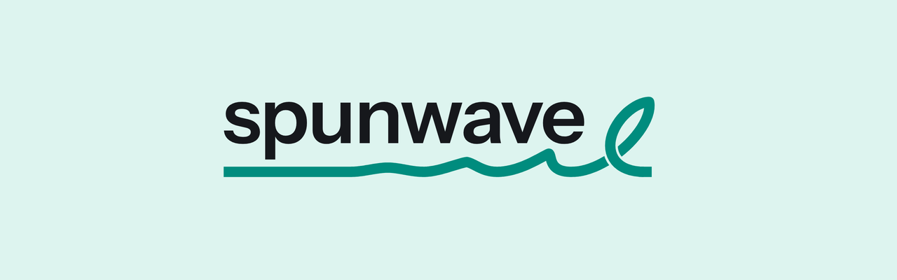
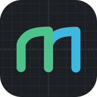
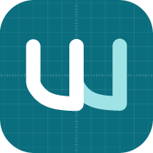

**We made the NI myDAQ work without NI's software.** spunwave is Martin Dolez, Alex Uzun and Jean-Gabriel David.

### mybench

Bench instruments for the NI myDAQ: multimeter, oscilloscope, waveform generator, Bode and spectrum analyzers and more, in one window. macOS, Windows, Linux, through a USB driver we wrote ourselves. Free; the app is open source. 
[mybench.spunwave.com](https://mybench.spunwave.com) · [spunwave/mybench](https://github.com/spunwave/mybench)

### mybench Web · coming soon

The myDAQ instruments in your browser, nothing to install. 
[mybench.spunwave.com/web](https://mybench.spunwave.com/web/)

### Us

- **Martin Dolez** · [martin@spunwave.com](mailto:martin@spunwave.com) · [elektricM](https://github.com/elektricM)
- **Alex Uzun** · [alex@spunwave.com](mailto:alex@spunwave.com) · [ItsJupiter21](https://github.com/ItsJupiter21)
- **Jean-Gabriel David** · [jg@spunwave.com](mailto:jg@spunwave.com)

Write to all three of us: [contact@spunwave.com](mailto:contact@spunwave.com)
